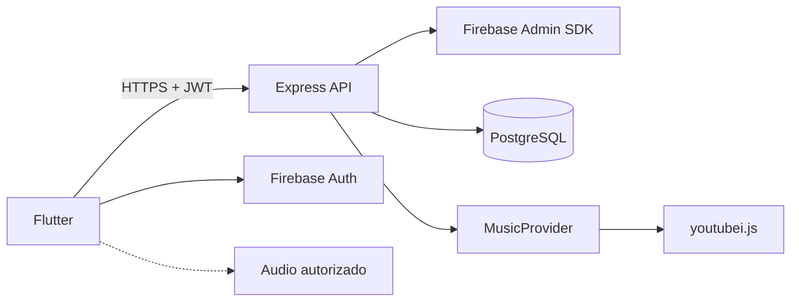

# Mysic

**Aplicación móvil de exploración musical con biblioteca personalizada, autenticación Google y funcionalidades sociales.**

Mysic es un proyecto personal y académico desarrollado con Flutter, Node.js, Express y PostgreSQL.

Permite explorar un catálogo musical, gestionar playlists, guardar favoritos, calificar canciones, publicar comentarios y consultar estadísticas de escucha.

La autenticación se realiza mediante Google Sign-In y Firebase Authentication.

> Estado: Sprint 1 cerrado (`sprint-01-v0.1.0`). Sprint 2 cerrado (`sprint-02-v0.2.0`). Sprint 3: perfiles PostgreSQL implementados y persistencia validada manualmente; CI y cierre pendientes.
>
> El catálogo experimental utiliza `youtubei.js` desde el backend. La disponibilidad de metadatos no garantiza acceso autorizado a streams de audio. La reproducción se valida por separado mediante fuentes compatibles y permitidas.

## Características previstas

- Inicio de sesión con Google.
- Perfiles de usuario.
- Búsqueda musical.
- Reproductor de audio.
- Reproducción en segundo plano.
- Playlists personales.
- Favoritos.
- Calificaciones.
- Comentarios.
- Historial de escucha.
- Estadísticas personales.
- Sincronización de datos en PostgreSQL.

## Stack tecnológico

| Capa | Tecnología |
|---|---|
| Mobile | Flutter / Dart |
| Backend | Node.js / Express / TypeScript |
| Autenticación | Firebase Auth / Google Sign-In |
| Validación JWT | Firebase Admin SDK |
| Base de datos | PostgreSQL / Supabase |
| ORM | Prisma |
| Catálogo experimental | youtubei.js |
| Reproductor | just_audio / audio_service |
| Estado | Riverpod |
| Navegación | go_router |
| Gestor de paquetes backend | pnpm |
| Versionado | Git / GitHub |

## Arquitectura



El backend gestiona autenticación, autorización, catálogo y persistencia.

La aplicación móvil no accede directamente a PostgreSQL.

## Estructura del repositorio

```text
Mysic_App/
├── AGENTS.md
├── README.md
├── .gitignore
├── docs/
│   ├── 01-arquitectura.md
│   ├── 02-base-de-datos.md
│   ├── 03-requisitos.md
│   └── 04-sprints-roadmap.md
├── backend/
│   ├── src/
│   ├── prisma/
│   ├── tests/
│   ├── package.json
│   ├── pnpm-lock.yaml
│   └── .env.example
├── mobile/
│   ├── lib/
│   ├── test/
│   ├── android/
│   ├── ios/
│   └── pubspec.yaml
└── .github/
    └── workflows/
```

`backend/` y `mobile/` (Android) están implementados como base del Sprint 1. Health y el arranque Android fueron demostrados localmente. Consultar [seguimiento](docs/05-sprint-01-seguimiento.md) y [mobile/README.md](mobile/README.md). iOS queda para una ampliación.

## Requisitos previos

### Obligatorios

- Git.
- Cuenta de GitHub.
- Acceso SSH configurado.
- Node.js LTS compatible.
- pnpm.
- Flutter SDK.
- Android SDK.
- Java JDK compatible.
- Proyecto Firebase (se configura en Sprint 2).
- Proyecto Supabase PostgreSQL (se configura en Sprint 3).

### Recomendados

- VS Code.
- Android Studio.
- Docker.
- PostgreSQL Client.
- Dispositivo Android físico.

Verificar instalación:

```bash
git --version
node --version
pnpm --version
flutter doctor -v
java -version
```

## 1. Clonar el repositorio

Comprobar conexión SSH:

```bash
ssh -T git@github.com
```

Clonar:

```bash
git clone git@github.com:MarckDL/Mysic_App.git
cd Mysic_App
```

Verificar remoto:

```bash
git remote -v
```

Si el repositorio es privado, se necesitan permisos de acceso.

## 2. Configurar backend

Entrar en el directorio:

```bash
cd backend
```

Instalar dependencias:

```bash
pnpm install --frozen-lockfile
```

Crear archivo de entorno a partir de la plantilla:

```bash
cp .env.example .env
```

Variables actuales:

```dotenv
NODE_ENV=development
PORT=3000
FIREBASE_PROJECT_ID=your-project-id
GOOGLE_APPLICATION_CREDENTIALS=/absolute/path/outside-repository/service-account.json
```

Los valores anteriores son ejemplos, no credenciales reales. El JSON administrativo
se guarda fuera del repositorio. En infraestructura administrada se puede usar ADC
sin archivo de clave. `DATABASE_URL` y Prisma se añadirán en el Sprint 3.
Nunca subir `.env` ni credenciales administrativas a Git.

### Inicializar Prisma

Cuando se haya creado el esquema:

```bash
pnpm exec prisma generate
pnpm exec prisma migrate dev
```

Para migraciones ya existentes en un entorno desplegado:

```bash
pnpm exec prisma migrate deploy
```

### Ejecutar servidor

Ejecutar en desarrollo:

```bash
pnpm dev
```

Endpoint esperado:

```text
http://localhost:3000/api/v1/health
```

Ejemplo de respuesta:

```json
{
  "status": "ok"
}
```

## 3. Configurar Firebase

Consultar la guía paso a paso del [Sprint 2](docs/06-sprint-02-autenticacion.md).

1. Crear un proyecto Firebase y habilitar Authentication con Google.
2. Registrar Android con paquete `com.mysic.mysic` y las huellas SHA del equipo.
3. Descargar `google-services.json` de esa app después de habilitar Google.
4. Desde `mobile/`, convertirlo con `python3 tool/configure_firebase.py /ruta/google-services.json`.
5. Configurar el mismo proyecto y ADC en el backend.
6. Ejecutar `flutter run --dart-define-from-file=config/firebase.android.json`.

La configuración cliente se carga mediante `FirebaseOptions` y un `serverClientId`
OAuth web explícito. No se necesita aplicar Google Services en Gradle para esta
modalidad ni importar un archivo `firebase_options.dart`. CI compila sin datos de
un proyecto real; el login real requiere configuración y verificación independientes.
Los archivos de configuración locales están excluidos de Git.

## 4. Configurar Flutter

Desde la raíz:

```bash
cd mobile
```

Instalar dependencias:

```bash
flutter pub get
```

Comprobar entorno:

```bash
flutter doctor -v
```

Listar dispositivos:

```bash
flutter devices
```

Ejecutar aplicación:

```bash
flutter run
```

Para utilizar un dispositivo Android físico:

1. Activar opciones de desarrollador.
2. Activar depuración USB.
3. Conectar el dispositivo.
4. Confirmar autorización.
5. Ejecutar `flutter devices`.
6. Ejecutar `flutter run`.

### URL del backend

En Android Emulator, el host local suele ser accesible mediante:

```text
http://10.0.2.2:3000
```

En dispositivo físico, usar una dirección alcanzable desde el dispositivo, por ejemplo la IP local del equipo de desarrollo.

La configuración se definirá mediante `--dart-define` o un mecanismo equivalente.

Configuración prevista para la futura conexión HTTP:

```bash
flutter run \
  --dart-define=API_BASE_URL=http://10.0.2.2:3000
```

`ApiConfig` lee esta variable y el cliente de sesión solicita `/api/v1/auth/session`
con un Firebase ID token. Se requiere Firebase configurado y el backend activo.

El tráfico HTTP local requiere configuración de desarrollo apropiada. Los despliegues remotos deben utilizar HTTPS.

## 5. Pruebas

### Backend

```bash
cd backend
pnpm test
pnpm lint
```

### Flutter

```bash
cd mobile
flutter analyze
flutter test
```

Backend también dispone de `pnpm typecheck`, `pnpm format:check` y `pnpm build`. Las verificaciones requieren instalar primero las dependencias.

## 6. Generar APK

Desde `mobile/`:

```bash
flutter build apk --release
```

Ruta habitual de salida:

```text
build/app/outputs/flutter-apk/app-release.apk
```

La configuración de Firebase, la firma Android y la URL del backend deben verificarse antes de distribuir una compilación de prueba.

## 7. Roadmap

| Sprint | Objetivo |
|---|---|
| 01 | Fundamentos |
| 02 | Google Sign-In |
| 03 | PostgreSQL y usuarios |
| 04 | Catálogo |
| 05 | Viabilidad de reproducción |
| 06 | Reproductor |
| 07 | Playlists |
| 08 | Favoritos y ratings |
| 09 | Comentarios |
| 10 | Historial |
| 11 | Estadísticas |
| 12 | Optimización |
| 13 | Pruebas |
| 14 | Entrega académica |

Cada Sprint tiene una duración estimada de dos semanas.

Consultar `docs/04-sprints-roadmap.md`.

## 8. Convención Git

Utilizar Conventional Commits:

```text
feat(auth): add Google Sign-In
feat(playlists): implement CRUD
fix(catalog): handle provider errors
docs: update architecture
```

Al finalizar y verificar cada Sprint, se debe realizar commit, push y etiqueta formal de versión.

Ejemplo:

```bash
git add .
git commit -m "chore(sprint-01): complete foundation"
git push origin main
git tag -a sprint-01-v0.1.0 -m "Sprint 01 verified"
git push origin sprint-01-v0.1.0
```

No ejecutar el cierre sin revisar cambios, pruebas y secretos.

## 9. Documentación

- [Arquitectura](docs/01-arquitectura.md)
- [Base de datos](docs/02-base-de-datos.md)
- [Requisitos](docs/03-requisitos.md)
- [Roadmap](docs/04-sprints-roadmap.md)
- [Instrucciones para agentes](AGENTS.md)

## 10. Limitaciones

- youtubei.js utiliza interfaces no oficiales.
- Los metadatos externos pueden cambiar.
- El acceso a streams puede estar restringido.
- El backend gratuito puede suspenderse por inactividad.
- Las cuotas de Firebase y Supabase están sujetas a sus condiciones vigentes.
- La reproducción debe utilizar mecanismos compatibles y autorizados.

## 11. Autor

MarckDL

Proyecto académico y de portafolio.

## 12. Estado

En desarrollo.

La documentación describe el diseño objetivo; no implica que todos los módulos estén implementados.
