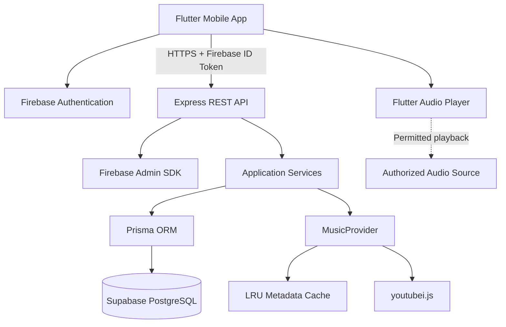
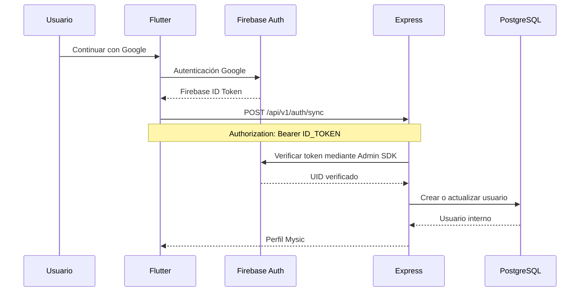

# Mysic — Documento de arquitectura

**Versión:** 1.0.0  
**Estado:** Arquitectura inicial propuesta  
**Tipo:** Proyecto personal y académico  
**Plataformas:** Android inicialmente; iOS como ampliación

## 1. Objetivo

Mysic es una aplicación móvil de exploración y reproducción musical que permite a los usuarios autenticarse con Google, buscar canciones, crear playlists, guardar favoritos, calificar, comentar y consultar estadísticas personales.

El proyecto tiene fines académicos y de portafolio. No contempla monetización, distribución comercial ni publicación inicial en tiendas.

## 2. Principios arquitectónicos

1. Separación entre presentación, dominio e infraestructura.
2. Backend como punto central de acceso a datos y servicios externos.
3. Identidad verificada en todas las operaciones privadas.
4. Persistencia centralizada y aislamiento multiusuario.
5. Integraciones externas reemplazables mediante interfaces.
6. Uso mínimo de infraestructura y servicios gratuitos.
7. Pruebas automatizadas para funcionalidades críticas.
8. Secretos y credenciales administrativas fuera del repositorio.

## 3. Stack tecnológico

| Componente | Tecnología |
|---|---|
| Aplicación móvil | Flutter y Dart |
| Estado | Riverpod |
| Navegación | go_router |
| Cliente HTTP | Dio |
| Reproducción | just_audio, audio_service, audio_session |
| Autenticación | Firebase Auth y Google Sign-In |
| Backend | Node.js 22 LTS o versión LTS compatible, Express, TypeScript |
| Validación de identidad | Firebase Admin SDK |
| Base de datos | PostgreSQL mediante Supabase |
| ORM | Prisma |
| Catálogo experimental | youtubei.js |
| Caché de metadatos | LRU en memoria |
| Caché local | SQLite / Drift, si es necesario |
| Testing backend | Vitest y Supertest |
| Testing Flutter | flutter_test |
| CI | GitHub Actions |
| Hosting | Render o Railway |

Docker es recomendado para desarrollo local, pero no obligatorio si se utiliza Supabase alojado.

## 4. Arquitectura general



### 4.1 Flutter

Responsabilidades:

- Pantallas de inicio de sesión y perfil.
- Búsqueda y exploración musical.
- Interfaz del reproductor.
- Gestión de playlists y favoritos.
- Calificaciones y comentarios.
- Historial y estadísticas.
- Gestión de estado y navegación.
- Almacenamiento temporal no sensible.

Flutter nunca recibe credenciales administrativas de Firebase o PostgreSQL.

### 4.2 Backend Express

Responsabilidades:

- Exponer endpoints REST versionados.
- Validar Firebase ID tokens.
- Resolver la identidad interna del usuario.
- Autorizar operaciones por propietario.
- Gestionar reglas de negocio.
- Acceder a PostgreSQL mediante Prisma.
- Consultar proveedores musicales.
- Normalizar metadatos y gestionar caché.
- Aplicar rate limiting y validación de entrada.
- Proporcionar respuestas de error consistentes.

### 4.3 youtubei.js

La librería `youtubei.js` debe ejecutarse exclusivamente en Node.js, dentro de `backend/`.

Se utilizará como integración experimental para:

- Buscar videos musicales.
- Obtener títulos, artistas y miniaturas.
- Consultar duraciones y otros metadatos disponibles.
- Normalizar identificadores externos.
- Investigar la viabilidad técnica del catálogo.

La librería no debe importarse en Flutter.

Las interfaces internas de YouTube no constituyen una API pública estable. El uso personal o académico no elimina las condiciones de uso ni los derechos sobre contenido musical.

### 4.4 MusicProvider

La aplicación no debe depender directamente de las estructuras internas de `youtubei.js`.

Contrato conceptual:

```typescript
export interface Track {
  source: string;
  sourceId: string;
  title: string;
  artistName: string;
  durationSeconds: number | null;
  thumbnailUrl: string | null;
}

export interface PlaybackResult {
  mode: "direct" | "embedded" | "unavailable";
  url?: string;
  expiresAt?: string;
  reason?: string;
}

export interface MusicProvider {
  search(query: string): Promise<Track[]>;
  getTrack(sourceId: string): Promise<Track | null>;
  resolvePlayback(sourceId: string): Promise<PlaybackResult>;
}
```

`resolvePlayback` solamente puede devolver una fuente reproducible cuando exista un mecanismo autorizado y compatible.

Para las pruebas del reproductor se utilizará un conjunto pequeño de archivos de audio propios, libres o expresamente autorizados.

## 5. Flujo de autenticación



### Reglas de identidad

- `users.id`: UUID interno y clave primaria.
- `users.firebase_uid`: identificador único de Firebase.
- `users.google_id`: identificador del proveedor Google, cuando esté disponible.
- Las relaciones utilizan `users.id`.
- No se debe confiar en un `user_id` enviado por el cliente.
- El backend obtiene la identidad a partir del token validado.
- Los ID tokens se renuevan mediante el SDK de Firebase.
- Los tokens revocados o inválidos deben rechazarse.

## 6. Flujo de búsqueda

1. El usuario escribe una consulta en Flutter.
2. Flutter solicita `GET /api/v1/search?q=...`.
3. Express valida y normaliza la consulta.
4. El servicio comprueba la caché.
5. Si no hay resultados vigentes, consulta `youtubei.js`.
6. El adaptador convierte la respuesta al modelo `Track`.
7. Express devuelve JSON a Flutter.
8. Flutter presenta los resultados.

La búsqueda puede ser pública o requerir autenticación, según la política definitiva. Las operaciones de biblioteca y datos personales siempre requieren autenticación.

## 7. Flujo de reproducción

El reproductor Flutter utiliza `just_audio` y `audio_service`.

El backend puede proporcionar información sobre la disponibilidad de reproducción a través de:

`POST /api/v1/playback/resolve`

Solicitud:

```json
{
  "source": "youtube",
  "sourceId": "external-track-id"
}
```

Respuesta conceptual:

```json
{
  "mode": "unavailable",
  "reason": "No authorized playback source configured"
}
```

Cuando exista una fuente autorizada de reproducción directa, la respuesta podrá incluir una URL temporal y su vencimiento.

### Restricciones importantes

- No asumir que los enlaces internos de YouTube son permanentes.
- No almacenar URLs de audio firmadas como datos duraderos.
- No exponer cookies, credenciales ni tokens privados.
- No convertir Express en un proxy de retransmisión musical sin autorización.
- No implementar mecanismos para evadir controles de acceso, DRM o restricciones del proveedor.
- Documentar la viabilidad real de reproducción en el Sprint 5.

## 8. Estrategia de caché

| Recurso | TTL inicial |
|---|---|
| Búsqueda | 10 minutos |
| Metadatos de canciones | 1 hora |
| Metadatos de artistas | 6 horas |
| Errores transitorios | 30 segundos |
| URLs temporales de audio | No persistir como caché general |

Los TTL son parámetros iniciales sujetos a revisión y a las condiciones del proveedor.

La caché debe limitar el número de entradas y no almacenar información sensible.

## 9. Organización del backend

```text
backend/src/
├── app.ts
├── server.ts
├── config/
├── middleware/
│   ├── auth.middleware.ts
│   └── error.middleware.ts
├── modules/
│   ├── auth/
│   ├── users/
│   ├── catalog/
│   ├── playback/
│   ├── playlists/
│   ├── favorites/
│   ├── ratings/
│   ├── comments/
│   ├── history/
│   └── statistics/
├── providers/
│   ├── music-provider.ts
│   └── youtube.provider.ts
├── infrastructure/
│   ├── database/
│   └── cache/
└── shared/
```

## 10. Organización de Flutter

```text
mobile/lib/
├── main.dart
├── app/
│   ├── router/
│   └── theme/
├── core/
│   ├── network/
│   ├── auth/
│   └── errors/
├── features/
│   ├── authentication/
│   ├── home/
│   ├── search/
│   ├── player/
│   ├── playlists/
│   ├── favorites/
│   ├── ratings/
│   ├── comments/
│   ├── history/
│   └── statistics/
└── shared/
```

Cada feature debe separar, cuando sea útil:

- presentation
- domain
- data

## 11. Seguridad

- HTTPS para las comunicaciones remotas.
- Firebase Admin SDK para verificar ID tokens.
- Validación de entrada mediante Zod u otra librería equivalente.
- Autorización por recurso en el backend.
- Consultas parametrizadas mediante Prisma.
- Rate limiting en endpoints sensibles.
- Límites de tamaño para comentarios y solicitudes.
- Secretos exclusivamente en variables de entorno.
- Logging sin tokens ni información sensible.
- Protección frente a enumeración de usuarios.
- Eliminación de cuenta y datos personales.

## 12. Estrategia de despliegue

### Desarrollo

- Flutter ejecutado en emulador o dispositivo Android.
- Express ejecutado localmente.
- PostgreSQL mediante Supabase o Docker.
- Firebase configurado en un proyecto de desarrollo.

### Demostración académica

- Backend desplegado en Render o Railway.
- PostgreSQL administrado por Supabase.
- Firebase Authentication.
- APK privado para instalación de prueba.

El plan gratuito de hosting puede presentar suspensión por inactividad, cuotas o cambios de condiciones.

## 13. Pruebas

### Backend

- Pruebas unitarias de servicios.
- Pruebas de integración de rutas.
- Pruebas de validación JWT.
- Pruebas de autorización multiusuario.
- Pruebas de integridad de playlists.
- Pruebas de manejo de errores externos.

### Flutter

- Pruebas de widgets.
- Pruebas de navegación.
- Pruebas de estados de autenticación.
- Pruebas del reproductor con audio autorizado.
- Pruebas de sincronización de datos.

## 14. Decisiones pendientes

- Validación de viabilidad de reproducción con la fuente experimental.
- Selección final de hosting gratuito.
- Alcance definitivo de caché offline.
- Estrategia de moderación para comentarios públicos.
- Compatibilidad futura con iOS.

Cualquier cambio arquitectónico relevante debe documentarse antes de implementarse.

## 15. Incremento Sprint 02: sesión verificada

`GET /api/v1/auth/session` es la ruta privada inicial de comprobación. Devuelve
solo Firebase UID y proveedor; no crea perfiles ni UUID internos. `/auth/sync`
y `/users/me` se mantienen en Sprint 03 con PostgreSQL. La identidad de Firebase
no se presenta como un usuario ya persistido.

Flutter usa Firebase Auth y Google Sign-In nativo, Riverpod para sesión/acciones
y Dio para consultar el backend. El gate muestra el inicio solo después de validar
la sesión en Express. El SDK renueva ID tokens; ante 401 se fuerza una renovación
y se reintenta una sola vez el GET de sesión. Un segundo 401 o un 403 cierra
la sesión local. No se reintentan operaciones de escritura.

Firebase Admin comprueba firma, expiración, proyecto y revocación mediante
`verifyIdToken(token, true)`. Solo se admite el proveedor google.com. No se aceptan
identidades del body, query ni tokens de emulador Firebase sin firma. Los fallos
operativos devuelven 503; un token inválido devuelve 401 y otro proveedor 403.

La configuración cliente se carga con FirebaseOptions y un client ID OAuth web
explícito (`serverClientId`), sin depender de archivos generados ignorados en CI.
Un conversor local obtiene esos identificadores de google-services.json. El SDK
Google documenta esta modalidad sin el plugin Gradle de Google Services. CI puede
compilar sin un proyecto real; no demuestra login real. Credenciales Admin van
fuera del repositorio y se cargan mediante ADC.

HTTP solo se admite en debug hacia localhost, 127.0.0.1 y 10.0.2.2. Android tiene
una excepción de red limitada a esos hosts solo en debug. Remotos usan HTTPS;
Dio no sigue redirecciones con el token. Configuración y pruebas reales pendientes
se registran en docs/06-sprint-02-autenticacion.md.

## 16. Incremento Sprint 03: perfiles persistentes

El perfil se sincroniza mediante POST /api/v1/auth/sync, con identidad y datos de
Google verificados en Firebase ID token; no acepta propietario desde Flutter.
GET /api/v1/users/me resuelve por Firebase UID y devuelve el UUID interno de users.
Prisma 7 utiliza adapter-pg y un cliente generado ESM. La tabla reside en el esquema
privado mysic, sin políticas RLS de acceso cliente. No exponer este esquema en la
Data API de Supabase. El backend usa PostgreSQL; Supabase Auth no se incorpora.

Flutter exige sync antes de mostrar inicio. Un fallo de persistencia permite
reintentar sin borrar la identidad Firebase; el cambio de cuenta invalida los datos
anteriores. /auth/session y /health siguen funcionando sin base de datos disponible.
Las pruebas PostgreSQL usan una base desechable independiente en CI.
