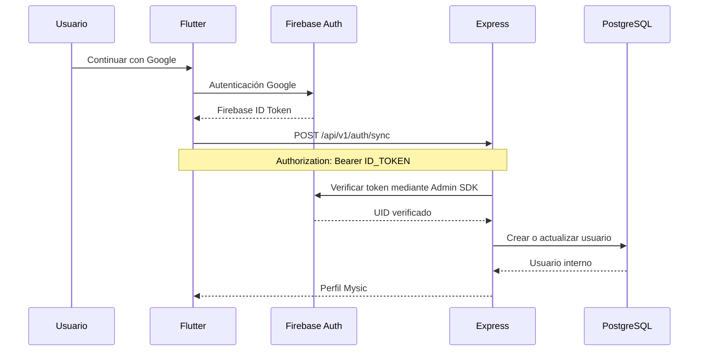

# Mysic — Documento de arquitectura

**Versión:** 1.0.0  
**Estado:** Arquitectura inicial propuesta  
**Tipo:** Proyecto personal y académico  
**Plataformas:** Android inicialmente; iOS como ampliación

## 1. Objetivo

Mysic es una aplicación móvil de exploración y reproducción musical que permite a los usuarios autenticarse con Google, buscar canciones, crear playlists, guardar favoritos, calificar, comentar y consultar estadísticas personales.

El proyecto tiene fines académicos y de portafolio. No contempla monetización, distribución comercial ni publicación inicial en tiendas.

## 2. Principios arquitectónicos

1. Separación entre presentación, dominio e infraestructura.
2. Backend como punto central de acceso a datos y servicios externos.
3. Identidad verificada en todas las operaciones privadas.
4. Persistencia centralizada y aislamiento multiusuario.
5. Integraciones externas reemplazables mediante interfaces.
6. Uso mínimo de infraestructura y servicios gratuitos.
7. Pruebas automatizadas para funcionalidades críticas.
8. Secretos y credenciales administrativas fuera del repositorio.

## 3. Stack tecnológico

| Componente              | Tecnología                                                   |
| ----------------------- | ------------------------------------------------------------ |
| Aplicación móvil        | Flutter y Dart                                               |
| Estado                  | Riverpod                                                     |
| Navegación              | go_router                                                    |
| Cliente HTTP            | Dio                                                          |
| Reproducción            | just_audio, audio_service, audio_session                     |
| Autenticación           | Firebase Auth y Google Sign-In                               |
| Backend                 | Node.js 22 LTS o versión LTS compatible, Express, TypeScript |
| Validación de identidad | Firebase Admin SDK                                           |
| Base de datos           | PostgreSQL mediante Supabase                                 |
| ORM                     | Prisma                                                       |
| Catálogo experimental   | youtubei.js                                                  |
| Resolución Android      | NewPipeExtractor detrás de MethodChannel                     |
| Caché de metadatos      | LRU en memoria                                               |
| Caché local             | SQLite / Drift, si es necesario                              |
| Testing backend         | Vitest y Supertest                                           |
| Testing Flutter         | flutter_test                                                 |
| CI                      | GitHub Actions                                               |
| Hosting                 | Render o Railway                                             |

Docker es recomendado para desarrollo local, pero no obligatorio si se utiliza Supabase alojado.

## 4. Arquitectura general

```mermaid
flowchart TD
    Flutter["Flutter Mobile App"]
    Firebase["Firebase Authentication"]
    API["Express REST API"]
    Admin["Firebase Admin SDK"]
    Services["Application Services"]
    Prisma["Prisma ORM"]
    DB[("Supabase PostgreSQL")]
    Provider["MusicProvider"]
    YouTube["youtubei.js"]
    Cache["LRU Metadata Cache"]
    Player["Flutter Audio Player"]
    CloudResolver["Cloud Playback Resolver"]
    DeviceResolver["Android Device Resolver"]
    Audio["Temporary Audio Stream"]

    Flutter --> Firebase
    Flutter -->|"HTTPS + Firebase ID Token"| API
    API --> Admin
    API --> Services
    Services --> Prisma
    Prisma --> DB
    Services --> Provider
    Provider --> Cache
    Provider --> YouTube
    Services --> CloudResolver
    CloudResolver --> Audio
    Flutter --> Player
    Player --> DeviceResolver
    DeviceResolver -->|"Ephemeral URL + HTTP Range"| Audio
    Player -. fallback .->|"Authenticated HTTP Range"| API
```

### 4.1 Flutter

Responsabilidades:

- Pantallas de inicio de sesión y perfil.
- Búsqueda y exploración musical.
- Interfaz del reproductor.
- Gestión de playlists y favoritos.
- Calificaciones y comentarios.
- Historial y estadísticas.
- Gestión de estado y navegación.
- Almacenamiento temporal no sensible.

Flutter nunca recibe credenciales administrativas de Firebase o PostgreSQL.

### 4.2 Backend Express

Responsabilidades:

- Exponer endpoints REST versionados.
- Validar Firebase ID tokens.
- Resolver la identidad interna del usuario.
- Autorizar operaciones por propietario.
- Gestionar reglas de negocio.
- Acceder a PostgreSQL mediante Prisma.
- Consultar proveedores musicales.
- Normalizar metadatos y gestionar caché.
- Aplicar rate limiting y validación de entrada.
- Proporcionar respuestas de error consistentes.

### 4.3 youtubei.js

La librería `youtubei.js` se ejecuta exclusivamente en Node.js, dentro de `backend/`.

Se utilizará como integración experimental para:

- Buscar videos musicales.
- Obtener títulos, artistas y miniaturas.
- Consultar duraciones y otros metadatos disponibles.
- Normalizar identificadores externos.
- Investigar la viabilidad técnica del catálogo.

La librería no debe importarse en Flutter.

Android dispone además de un adaptador nativo de reproducción. Este adaptador no
reemplaza `MusicProvider`: recibe solamente un ID ya normalizado, resuelve una URL
efímera en el dispositivo y la devuelve a `just_audio`. La integración queda detrás
de `PlaybackSourceResolver`; no llega a widgets ni módulos de catálogo.

Para acotar costo en el teléfono, utiliza un único ejecutor, una caché LRU de tres
resoluciones en memoria y reproducción HTTP Range directa. No descarga la canción
completa, no escribe audio en disco y no mantiene un servidor local.

El adaptador reutiliza un único cliente HTTP con dos solicitudes como máximo, pool
pequeño, DNS/TLS/HTTP2 reutilizables y compresión de respuestas de metadatos. Solo
la validación del último byte solicita `Accept-Encoding: identity`. La extracción
obtiene directamente `StreamExtractor`, ejecuta `fetchPage()` y consulta audio
progresivo, sin construir descripción, relacionados, subtítulos o video.

Tras verificar la sesión, Flutter conserva una instancia de `AudioPlayer`, configura
la sesión y calienta el extractor sin buscar ni descargar audio. Las búsquedas
estables durante 600 ms anticipan solo la primera pista y la cola solo la siguiente.
Android configura el reproductor con 250 ms de buffer para el primer inicio, 1 s
después de un rebuffer, ventana de 3–15 s y objetivo de 1 MiB. Este ajuste sustituye
el buffer inicial predeterminado más conservador sin introducir caché de audio,
proxy local ni persistencia.
El canal implementa `warmUp`, `resolve`, `prefetch`, `cancelPrefetch` y `clear`;
resoluciones iguales comparten un single-flight y una reproducción explícita cancela
anticipaciones obsoletas. Logout y cierre eliminan caché y reproductor.

Las interfaces internas de YouTube no constituyen una API pública estable. El uso personal o académico no elimina las condiciones de uso ni los derechos sobre contenido musical.

### 4.4 MusicProvider

La aplicación no debe depender directamente de las estructuras internas de `youtubei.js`.

Contrato conceptual:

```typescript
export interface Track {
  source: string;
  sourceId: string;
  title: string;
  artistName: string;
  durationSeconds: number | null;
  thumbnailUrl: string | null;
}

export interface PlaybackResult {
  mode: "direct" | "embedded" | "unavailable";
  url?: string;
  expiresAt?: string;
  reason?: string;
}

export interface MusicProvider {
  search(query: string): Promise<Track[]>;
  getTrack(sourceId: string): Promise<Track | null>;
  resolvePlayback(sourceId: string): Promise<PlaybackResult>;
}
```

`resolvePlayback` solamente devuelve una fuente después de validar identidad,
formato, duración completa, caducidad y capacidad real de entrega por rangos.

## 5. Flujo de autenticación



### Reglas de identidad

- `users.id`: UUID interno y clave primaria.
- `users.firebase_uid`: identificador único de Firebase.
- `users.google_id`: identificador del proveedor Google, cuando esté disponible.
- Las relaciones utilizan `users.id`.
- No se debe confiar en un `user_id` enviado por el cliente.
- El backend obtiene la identidad a partir del token validado.
- Los ID tokens se renuevan mediante el SDK de Firebase.
- Los tokens revocados o inválidos deben rechazarse.

## 6. Flujo de búsqueda

1. El usuario escribe una consulta en Flutter.
2. Flutter solicita `GET /api/v1/search?q=...`.
3. Express valida y normaliza la consulta.
4. El servicio comprueba la caché.
5. Si no hay resultados vigentes, consulta `youtubei.js`.
6. El adaptador convierte la respuesta al modelo `Track`.
7. Express devuelve JSON a Flutter.
8. Flutter presenta los resultados.

La búsqueda puede ser pública o requerir autenticación, según la política definitiva. Las operaciones de biblioteca y datos personales siempre requieren autenticación.

## 7. Flujo de reproducción

El reproductor Flutter utiliza `just_audio` y `audio_service`.

El backend continúa proporcionando información de disponibilidad a través de:

`POST /api/v1/playback/resolve`

Solicitud:

```json
{
  "source": "youtube",
  "sourceId": "external-track-id"
}
```

Respuesta conceptual:

```json
{
  "mode": "unavailable",
  "reason": "No complete playback source available"
}
```

En Android autenticado, `PlaybackSourceResolver` intenta la resolución nativa porque
el proveedor rechazó de forma reproducible las IP de Render. El resultado solo vive
en memoria y `just_audio` solicita por rangos los bytes requeridos. En plataformas
sin adaptador nativo se conserva la ruta autenticada del backend como fallback.

### Restricciones importantes

- No asumir que los enlaces internos de YouTube son permanentes.
- No almacenar URLs de audio firmadas como datos duraderos.
- No imprimir URLs firmadas en logs o telemetría.
- Permitir un solo trabajo de extracción Android y como máximo tres entradas en RAM.
- No exponer cookies, credenciales ni tokens privados.
- En backend, ejecutar código dinámico del proveedor solo en un trabajador aislado.
  En Android, el adaptador nativo no recibe tokens Firebase ni credenciales de Mysic.
- Validar el último rango del medio antes de aceptar una URL; un primer megabyte
  accesible no demuestra que la pista completa esté disponible.
- Limitar concurrencia, bytes, duración, destinos de red y reintentos del proxy.
- Documentar la viabilidad real de reproducción en el Sprint 5.

## 8. Estrategia de caché

| Recurso                  | TTL inicial                     |
| ------------------------ | ------------------------------- |
| Búsqueda                 | 10 minutos                      |
| Metadatos de canciones   | 1 hora                          |
| Metadatos de artistas    | 6 horas                         |
| Errores transitorios     | 30 segundos                     |
| URLs temporales de audio | No persistir como caché general |

Los TTL son parámetros iniciales sujetos a revisión y a las condiciones del proveedor.

La caché debe limitar el número de entradas y no almacenar información sensible.

## 9. Organización del backend

```text
backend/src/
├── app.ts
├── server.ts
├── config/
├── middleware/
│   ├── auth.middleware.ts
│   └── error.middleware.ts
├── modules/
│   ├── auth/
│   ├── users/
│   ├── catalog/
│   ├── playback/
│   ├── playlists/
│   ├── favorites/
│   ├── ratings/
│   ├── comments/
│   ├── history/
│   └── statistics/
├── providers/
│   ├── music-provider.ts
│   └── youtube.provider.ts
├── infrastructure/
│   ├── database/
│   └── cache/
└── shared/
```

## 10. Organización de Flutter

```text
mobile/lib/
├── main.dart
├── app/
│   ├── router/
│   └── theme/
├── core/
│   ├── network/
│   ├── auth/
│   └── errors/
├── features/
│   ├── authentication/
│   ├── home/
│   ├── search/
│   ├── player/
│   ├── playlists/
│   ├── favorites/
│   ├── ratings/
│   ├── comments/
│   ├── history/
│   └── statistics/
└── shared/
```

Cada feature debe separar, cuando sea útil:

- presentation
- domain
- data

## 11. Seguridad

- HTTPS para las comunicaciones remotas.
- Firebase Admin SDK para verificar ID tokens.
- Validación de entrada mediante Zod u otra librería equivalente.
- Autorización por recurso en el backend.
- Consultas parametrizadas mediante Prisma.
- Rate limiting en endpoints sensibles.
- Límites de tamaño para comentarios y solicitudes.
- Secretos exclusivamente en variables de entorno.
- Logging sin tokens ni información sensible.
- Protección frente a enumeración de usuarios.
- Eliminación de cuenta y datos personales.

## 12. Estrategia de despliegue

### Desarrollo

- Flutter ejecutado en emulador o dispositivo Android.
- Express ejecutado localmente.
- PostgreSQL mediante Supabase o Docker.
- Firebase configurado en un proyecto de desarrollo.

### Demostración académica

- Backend desplegado en Render o Railway.
- PostgreSQL administrado por Supabase.
- Firebase Authentication.
- APK privado para instalación de prueba.

El plan gratuito de hosting puede presentar suspensión por inactividad, cuotas o cambios de condiciones.

### Despliegue preliminar desde Sprint 07

Para no posponer la validación remota hasta la entrega, Sprint 07 incorpora un
servicio Express preliminar en Render definido por `render.yaml`. Supabase conserva
PostgreSQL y Firebase Admin verifica la misma identidad usada por Android. El APK
recibe la URL HTTPS mediante `API_BASE_URL`; ningún secreto se compila en Flutter.

Esta instancia permite probar login, catálogo, playlists y transporte de audio desde
otra red. El plan gratuito es solo una validación técnica: el arranque en frío y el
ancho de banda del proxy de audio se medirán antes de decidir el plan de la demo.

## 13. Pruebas

### Backend

- Pruebas unitarias de servicios.
- Pruebas de integración de rutas.
- Pruebas de validación JWT.
- Pruebas de autorización multiusuario.
- Pruebas de integridad de playlists.
- Pruebas de manejo de errores externos.

### Flutter

- Pruebas de widgets.
- Pruebas de navegación.
- Pruebas de estados de autenticación.
- Pruebas del reproductor con streams iniciales, intermedios y finales.
- Pruebas de sincronización de datos.

## 14. Decisiones pendientes

- Validación de viabilidad de reproducción con la fuente experimental.
- Selección final de hosting gratuito.
- Alcance definitivo de caché offline.
- Estrategia de moderación para comentarios públicos.
- Compatibilidad futura con iOS.

Cualquier cambio arquitectónico relevante debe documentarse antes de implementarse.

## 15. Incremento Sprint 02: sesión verificada

`GET /api/v1/auth/session` es la ruta privada inicial de comprobación. Devuelve
solo Firebase UID y proveedor; no crea perfiles ni UUID internos. `/auth/sync`
y `/users/me` se mantienen en Sprint 03 con PostgreSQL. La identidad de Firebase
no se presenta como un usuario ya persistido.

Flutter usa Firebase Auth y Google Sign-In nativo, Riverpod para sesión/acciones
y Dio para consultar el backend. El gate muestra el inicio solo después de validar
la sesión en Express. El SDK renueva ID tokens; ante 401 se fuerza una renovación
y se reintenta una sola vez el GET de sesión. Un segundo 401 o un 403 cierra
la sesión local. No se reintentan operaciones de escritura.

Firebase Admin comprueba firma, expiración, proyecto y revocación mediante
`verifyIdToken(token, true)`. Solo se admite el proveedor google.com. No se aceptan
identidades del body, query ni tokens de emulador Firebase sin firma. Los fallos
operativos devuelven 503; un token inválido devuelve 401 y otro proveedor 403.

La configuración cliente se carga con FirebaseOptions y un client ID OAuth web
explícito (`serverClientId`), sin depender de archivos generados ignorados en CI.
Un conversor local obtiene esos identificadores de google-services.json. El SDK
Google documenta esta modalidad sin el plugin Gradle de Google Services. CI puede
compilar sin un proyecto real; no demuestra login real. Credenciales Admin van
fuera del repositorio y se cargan mediante ADC.

HTTP solo se admite en debug hacia localhost, 127.0.0.1 y 10.0.2.2. Android tiene
una excepción de red limitada a esos hosts solo en debug. Remotos usan HTTPS;
Dio no sigue redirecciones con el token. Configuración y pruebas reales pendientes
se registran en docs/06-sprint-02-autenticacion.md.

## 16. Incremento Sprint 03: perfiles persistentes

El perfil se sincroniza mediante POST /api/v1/auth/sync, con identidad y datos de
Google verificados en Firebase ID token; no acepta propietario desde Flutter.
GET /api/v1/users/me resuelve por Firebase UID y devuelve el UUID interno de users.
Prisma 7 utiliza adapter-pg y un cliente generado ESM. La tabla reside en el esquema
privado mysic, sin políticas RLS de acceso cliente. No exponer este esquema en la
Data API de Supabase. El backend usa PostgreSQL; Supabase Auth no se incorpora.

Flutter exige sync antes de mostrar inicio. Un fallo de persistencia permite
reintentar sin borrar la identidad Firebase; el cambio de cuenta invalida los datos
anteriores. /auth/session y /health siguen funcionando sin base de datos disponible.
Las pruebas PostgreSQL usan una base desechable independiente en CI.

## 17. Incremento Sprint 04: catálogo experimental

Búsqueda y detalle son autenticados. YoutubeProvider encapsula youtubei.js 18.3.0;
Flutter solo recibe Track de Mysic. El ID de catálogo es youtube:<sourceId>, distinto
de los UUID de tablas persistidas. Todavía no se persisten tracks ni audio.

CatalogService limita, coalesce y cachea metadatos: LRU de 100 búsquedas (10 min)
y 500 detalles (1 hora); no cachea fallos. Máximo 8 operaciones externas distintas
en vuelo y 10 segundos por operación con abort. Límite por UID de 30 solicitudes
por minuto, aplicado después de auth y antes de la caché. Son límites de un proceso.

Flutter usa go_router 18.1.1 dentro del gate de perfil verificado (Dart >=3.12),
GET autenticados con renovación única y pantallas de búsqueda/detalle. Cambio de
cuenta elimina navegación y solicitudes anteriores. No se habilita reproducción.
La evidencia y los pendientes se registran en docs/08-sprint-04-plan.md.

## 18. Incremento Sprint 05: reproducción de prueba

POST /api/v1/playback/resolve verifica Firebase Google, valida source/sourceId y
limita 30 resoluciones por UID/minuto. Registro explícito de MusicProvider:
YoutubeProvider (unavailable) y AuthorizedDemoProvider (asset sintético propio).

PlaybackResult es una unión discriminada: direct con delivery=asset, assetPath,
contentType y duración; embedded con URL (no habilitado); unavailable con motivo.
El servicio solo permite el asset registrado. No recibe URLs arbitrarias ni devuelve
credenciales. Resoluciones no-store, con timeout/abort y errores controlados.

Flutter utiliza just_audio 0.10.6 y audio_session 0.2.4 en una pantalla de prueba,
sin autoplay. Maneja foco, desconexión de auriculares, pausa al fondo y limpieza
al salir/cambiar de cuenta. No hay servicio de reproducción en segundo plano.
El asset no demuestra streaming HTTPS ni reproducción de YouTube. La validación
real de ese proveedor se trasladó expresamente a Sprint 06 por acuerdo del usuario.

## 19. Incremento Sprint 06: audio nativo experimental

Este apartado conserva el puente implementado antes de retirar R-007 como registro
histórico. Su limitación secuencial y ausencia de tokens ya no describen el código
actual; la política y la implementación vigente se documentan en
`docs/11-plan-resolucion-audio-letras.md`.

La preferencia confirmada del usuario es audio nativo de YouTube, sin reproductor
visible embebido. SABR no ofrece en este entorno una URL de archivo compatible con
just_audio. Se adapta la entrega mediante un puente de medios en el backend para
esta prueba; sustituye la hipótesis de entrega directa del plan inicial.

- POST /api/v1/playback/resolve conserva la demo y devuelve para YouTube una ruta
  candidata api-stream, ligada al mismo sourceId, seekable:false y
  availabilityVerified:false. Resolver una ruta no acredita escucha ni disponibilidad.
- GET /api/v1/playback/audio/:sourceId verifica Firebase/Google antes de abrir el
  proveedor. Devuelve MP4/AAC fragmentado sin URLs de CDN ni Firebase en el destino
  externo. No se admiten URLs arbitrarias, query params ni rangos distintos del inicio.
- youtubei.js y googlevideo permanecen en backend. El transporte funciona en un
  proceso hijo Node 24 con entorno de red limitado, sin variables Firebase/DB,
  sin permisos Node de escritura, procesos, addons o workers. El evaluador normal
  del SDK usa contexto VM con plazo de 500 ms, dentro de ese proceso. Ni VM ni los
  permisos Node se presentan como aislamiento de sistema operativo para código hostil.
- Se limitan destinos HTTPS del proveedor y se rechazan redirecciones de fetch.
  No hay cookies de usuario, generadores de tokens, cambios de identidad ni evasión
  de restricciones. Un rechazo del proveedor detiene la entrega.
- Máximo dos streams por instancia de backend, uno por UID; límite de aperturas,
  30 s de preparación, 20 min/100 MB por conexión. Hay backpressure y cancelación
  al desconectar. No se escriben archivos de audio ni URLs en BD/caché.
- Android utiliza just_audio con Authorization directo al backend (sin proxy local).
  Token renovado antes de cada apertura, controles play/pause/stop, sin seek. Se
  detiene al salir del detalle, cerrar/cambiar cuenta o ir al fondo. AudioSession
  pausa ante pérdida de foco o desconexión de auriculares, sin reanudación automática.
- Inicio incluye una prueba abierta de Big Buck Bunny con atribución. Los detalles
  del catálogo usan el ID exacto seleccionado. No se garantiza disponibilidad de
  todas las pistas ni se presume autorización a partir de sus metadatos.

Este incremento requiere Node 24, backend/tool/ además de dist/ y node_modules/.
El servicio multimedia de segundo plano, mini player y cola siguen pendientes.
Pruebas de escucha en Android y suites Flutter pendientes de ejecución del usuario.

## 20. Reproductor de sesión, cola y servicio multimedia — Sprint 06

Este incremento sustituye la pausa al navegar/ir al fondo descrita en la sección 19. El usuario confirmó escucha real desde búsqueda de «Unravel» y «Ravensky» de
Ado y los controles/cancelación del primer incremento. No se recibieron sus IDs,
por lo que no se inventan identificadores ni una matriz de disponibilidad universal.

CatalogNavigator mantiene un solo TrackPlaybackController mientras exista la sesión
verificada. Las pantallas, el mini reproductor, la vista /player y MysicAudioHandler
comparten ese controlador y su motor just_audio; ninguna vista crea otro reproductor.
Cerrar/cambiar cuenta elimina el navegador, detiene el motor y vacía cola y metadatos.
Renovar el token del mismo UID conserva la navegación y el audio.

La cola vive en memoria, máximo 100 elementos, sin duplicados al añadir. Reproducir
resultados sustituye la cola por los resultados actuales; reproducir una pista la
selecciona o añade a la cola existente. Añadir a la cola no inicia reproducción.
Hay anterior/siguiente, salto a un elemento, eliminación de elementos no actuales y
vaciar. El final avanza una sola vez; una pista fallida conserva un error y permite
reintentar o saltar manualmente, sin recorrer indefinidamente elementos fallidos.
La cola no es una playlist persistida ni genera historial en este sprint.

AudioService 0.18.19 se inicializa una vez en main. Su handler publica título,
artista, portada, duración y estado, y delega los controles al controlador activo.
No se incluyen ID tokens, headers ni URLs temporales de audio en MediaItem/cola.
El sistema extrapola la posición: no se reenvían cola/portada en cada tick del motor.
El mini reproductor muestra progreso y la pantalla completa ofrece slider de seek.
Al cerrar sesión se publica primero un MediaItem neutro y después null porque
audio_service 0.18 ignora null al sincronizar metadatos con Android; así no quedan
título, artista ni portada de la cuenta anterior en la MediaSession.

Android usa AudioServiceActivity, servicio mediaPlayback, MediaButtonReceiver,
WAKE_LOCK, FOREGROUND_SERVICE y FOREGROUND_SERVICE_MEDIA_PLAYBACK e icono propio.
androidStopForegroundOnPause:false permite continuar desde la notificación tras
pausar en segundo plano sin volver a iniciar el servicio desde una app oculta.
No se solicitan exclusiones de batería. Detener publica idle; retirar la tarea
solicita detener y vaciar la cola. No se promete supervivencia a muerte forzada del
proceso ni restauración automática de una cola perdida.

AudioSession pausa por foco/auriculares sin auto-resume; una interrupción durante
carga cancela la intención de reproducción. La demo local antigua limpia la cola
principal antes de cargar su diagnóstico para evitar audio simultáneo.

El transporte SABR secuencial fue sustituido por resolución PoToken multi-cliente y
un proxy HTTP Range. El backend valida inicio/final, tamaño, MIME, host y caducidad;
acepta rangos simples, conserva backpressure y re-resuelve una vez ante 403. El seek
de Flutter y del servicio multimedia usa esos rangos. Se mantienen una conexión por
UID, dos usuarios simultáneos por instancia y cancelación al desconectar. No se añade
precarga del cuerpo reproducible de otras canciones; solo se conserva la prueba final
acotada a 256 bytes. Al iniciar el backend se calienta el worker
sin seleccionar pista; la cola puede precargar solo la resolución de su siguiente ID
y la cancela al cambiar o vaciarse. Las métricas no contienen IDs, URLs ni tokens.

Referencias de implementación: https://pub.dev/packages/audio_service y su ejemplo
Android. Notificación, bloqueo de pantalla, cola, controles y logout se verificaron
en el dispositivo físico `23117RA68G` durante el cierre del Sprint 6.
