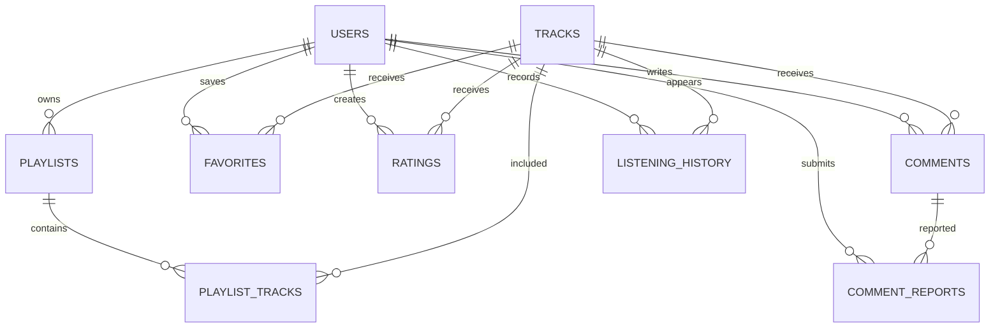

# Mysic — Diseño de base de datos

**Motor:** PostgreSQL  
**Servicio propuesto:** Supabase  
**ORM:** Prisma  
**Modelo:** Relacional, multiusuario

## 1. Objetivo

Diseñar una base de datos centralizada que permita almacenar usuarios autenticados mediante Google, playlists, favoritos, calificaciones, comentarios, historial y estadísticas.

La base de datos almacena información propia de Mysic y referencias a canciones externas, no archivos musicales.

## 2. Identidad del usuario

La tabla `users` almacena:

- `id`: UUID interno.
- `firebase_uid`: UID único emitido por Firebase Authentication.
- `google_id`: identificador del proveedor Google, cuando esté disponible y verificado.
- `email`: correo asociado a la cuenta.
- `display_name`: nombre mostrado.
- `photo_url`: URL de fotografía.
- `created_at`: fecha de creación.
- `updated_at`: última actualización.

### Regla fundamental

Aunque se conserva `google_id`, todas las claves foráneas utilizan `users.id`.

`firebase_uid` permite localizar la cuenta después de verificar el Firebase ID token.

No se permite que Flutter seleccione libremente el propietario de una operación.

## 3. Modelo entidad-relación



## 4. Diccionario de datos

### 4.1 users

| Campo | Tipo | Restricción |
|---|---|---|
| id | UUID | PK |
| firebase_uid | VARCHAR(128) | UNIQUE, NOT NULL |
| google_id | VARCHAR(255) | UNIQUE, NULL |
| email | VARCHAR(320) | NULL |
| display_name | VARCHAR(150) | NOT NULL |
| photo_url | TEXT | NULL |
| created_at | TIMESTAMPTZ | NOT NULL |
| updated_at | TIMESTAMPTZ | NOT NULL |

`email` no debe utilizarse como identificador estable de la cuenta.

### 4.2 tracks

| Campo | Tipo | Restricción |
|---|---|---|
| id | UUID | PK |
| source | VARCHAR(50) | NOT NULL |
| source_id | VARCHAR(255) | NOT NULL |
| title | VARCHAR(500) | NOT NULL |
| artist_name | VARCHAR(255) | NOT NULL |
| duration_seconds | INTEGER | NULL |
| thumbnail_url | TEXT | NULL |
| metadata_updated_at | TIMESTAMPTZ | NOT NULL |

Restricción: `UNIQUE(source, source_id)`.

La tabla representa referencias externas normalizadas.

### 4.3 playlists

| Campo | Tipo | Restricción |
|---|---|---|
| id | UUID | PK |
| user_id | UUID | FK users |
| name | VARCHAR(150) | NOT NULL |
| description | TEXT | NULL |
| visibility | VARCHAR(20) | NOT NULL |
| created_at | TIMESTAMPTZ | NOT NULL |
| updated_at | TIMESTAMPTZ | NOT NULL |

Valores de `visibility`: `private`, `public`.

Por defecto, las playlists son privadas.

### 4.4 playlist_tracks

| Campo | Tipo | Restricción |
|---|---|---|
| id | UUID | PK |
| playlist_id | UUID | FK playlists |
| track_id | UUID | FK tracks |
| position | INTEGER | NOT NULL |
| added_at | TIMESTAMPTZ | NOT NULL |

Se permiten canciones repetidas si el producto lo requiere.

Debe garantizarse una posición consistente dentro de cada playlist, utilizando transacciones al reordenar.

### 4.5 favorites

| Campo | Tipo | Restricción |
|---|---|---|
| user_id | UUID | FK users |
| track_id | UUID | FK tracks |
| created_at | TIMESTAMPTZ | NOT NULL |

Clave primaria compuesta: `(user_id, track_id)`.

### 4.6 ratings

| Campo | Tipo | Restricción |
|---|---|---|
| id | UUID | PK |
| user_id | UUID | FK users |
| track_id | UUID | FK tracks |
| score | SMALLINT | CHECK 1–5 |
| created_at | TIMESTAMPTZ | NOT NULL |
| updated_at | TIMESTAMPTZ | NOT NULL |

Restricción: `UNIQUE(user_id, track_id)`.

Un usuario mantiene una calificación activa por canción.

### 4.7 comments

| Campo | Tipo | Restricción |
|---|---|---|
| id | UUID | PK |
| user_id | UUID | FK users |
| track_id | UUID | FK tracks |
| body | TEXT | NOT NULL |
| status | VARCHAR(20) | NOT NULL |
| created_at | TIMESTAMPTZ | NOT NULL |
| updated_at | TIMESTAMPTZ | NOT NULL |

Estados: `visible`, `hidden`, `deleted`.

El contenido debe validarse, limitarse y moderarse.

### 4.8 listening_history

| Campo | Tipo | Restricción |
|---|---|---|
| id | UUID | PK |
| user_id | UUID | FK users |
| track_id | UUID | FK tracks |
| playback_session_id | UUID | UNIQUE |
| started_at | TIMESTAMPTZ | NOT NULL |
| listened_ms | BIGINT | NOT NULL |
| completed | BOOLEAN | NOT NULL |

`playback_session_id` permite evitar registros duplicados por reintentos.

### 4.9 comment_reports

| Campo | Tipo | Restricción |
|---|---|---|
| id | UUID | PK |
| reporter_id | UUID | FK users |
| comment_id | UUID | FK comments |
| reason | VARCHAR(100) | NOT NULL |
| status | VARCHAR(20) | NOT NULL |
| created_at | TIMESTAMPTZ | NOT NULL |

Estados: `pending`, `reviewed`, `dismissed`.

## 5. Estadísticas

Las estadísticas deben calcularse a partir de `listening_history`.

Indicadores:

- Canciones más escuchadas.
- Artistas más escuchados.
- Tiempo total de escucha.
- Cantidad de reproducciones.
- Actividad diaria y mensual.

Inicialmente no se requiere una tabla materializada `user_statistics`.

Si el rendimiento lo exige, se podrá incorporar una tabla agregada o vista materializada.

No contar automáticamente cada inicio de audio como una reproducción válida. El umbral deberá definirse en las reglas de negocio.

## 6. Índices recomendados

```sql
CREATE INDEX idx_playlists_user
ON playlists(user_id);

CREATE INDEX idx_comments_track_created
ON comments(track_id, created_at DESC);

CREATE INDEX idx_history_user_started
ON listening_history(user_id, started_at DESC);

CREATE INDEX idx_history_user_track
ON listening_history(user_id, track_id);
```

Estos índices son conceptuales; las migraciones definitivas se generarán mediante Prisma.

## 7. Reglas de autorización

### Datos privados

Solo el propietario puede:

- Modificar sus playlists.
- Administrar sus favoritos.
- Modificar sus calificaciones.
- Consultar su historial.
- Consultar sus estadísticas personales.
- Editar su perfil.

### Datos públicos

Los usuarios autenticados pueden:

- Consultar comentarios visibles.
- Consultar calificaciones agregadas.
- Consultar playlists declaradas públicas.

Solo el autor o un moderador autorizado puede modificar un comentario.

### Regla de implementación

Cada consulta privada debe incluir el identificador interno del usuario autenticado.

Ejemplo:

```typescript
const playlists = await prisma.playlist.findMany({
  where: {
    userId: authenticatedUser.id
  }
});
```

El backend nunca debe confiar en un `userId` proporcionado por Flutter.

## 8. Firebase y PostgreSQL

Flujo de asociación:

1. Flutter obtiene Firebase ID token.
2. Express verifica el token.
3. Express obtiene `firebase_uid`.
4. Express busca `users.firebase_uid`.
5. Si no existe, crea el usuario.
6. Las operaciones utilizan `users.id`.

El `google_id` debe obtenerse de información verificada del proveedor; nunca de un valor arbitrario enviado por el cliente.

## 9. Integridad y transacciones

- Claves foráneas obligatorias.
- Restricciones únicas para favoritos y ratings.
- Transacciones para reordenar playlists.
- Paginación en comentarios e historial.
- Eliminación controlada de datos personales.
- Fechas almacenadas en UTC.
- Validación de tamaños y tipos de datos.
- Migraciones versionadas con Prisma.

## 10. Eliminación de cuenta

La eliminación de cuenta debe coordinar:

1. Verificación de identidad.
2. Eliminación o anonimización de datos personales según la política.
3. Tratamiento de comentarios públicos.
4. Eliminación de datos relacionados en PostgreSQL.
5. Eliminación de la identidad de Firebase.

Se deben contemplar errores parciales y reintentos seguros.

## 11. PostgreSQL frente a NoSQL

Se selecciona PostgreSQL porque:

- Existen relaciones claras entre usuarios, canciones y playlists.
- Se requieren claves foráneas.
- Son importantes las restricciones únicas.
- Las estadísticas utilizan agregaciones SQL.
- Se necesita consistencia transaccional.

MongoDB no es necesario en la primera versión.

La caché de metadatos puede usar memoria o SQLite sin convertir la base principal a NoSQL.

## 12. Datos sensibles y seguridad

- No almacenar contraseñas de Google.
- No almacenar Firebase ID tokens en PostgreSQL.
- No guardar credenciales administrativas en tablas.
- No incluir cadenas de conexión en Git.
- Usar TLS en las conexiones remotas.
- Limitar los permisos del usuario de base de datos.
- Documentar backups y restauración.
- Probar aislamiento entre dos cuentas diferentes.

## 13. Migraciones

Prisma será la fuente principal del esquema relacional.

Comandos previstos:

```bash
npx prisma generate
npx prisma migrate dev --name init
npx prisma migrate deploy
```

`migrate dev` se utiliza en desarrollo.

`migrate deploy` se utiliza para aplicar migraciones existentes en entornos desplegados.

No ejecutar migraciones destructivas sin respaldo y revisión.

## 14. Implementación inicial Sprint 03

La tabla users se preparó en el esquema PostgreSQL dedicado `mysic` mediante
Prisma multi-schema. Este esquema no debe exponerse en la Data API de Supabase;
Flutter consulta únicamente Express. El cliente se genera en el backend y no se
versiona. La primera migración y la verificación de permisos están pendientes.
